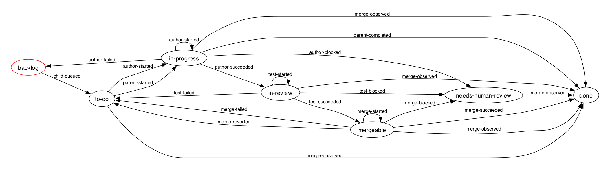
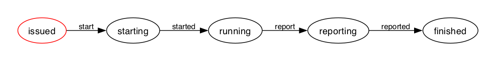
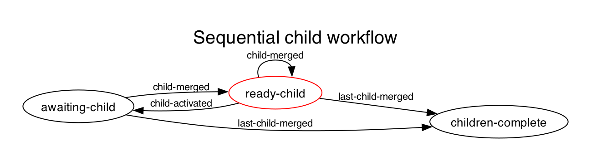

# kaneo-dispatcher

Turns a card move on the Kaneo board into a run in a Claude session pod.
Owned by me-myself-and-i.

Kaneo posts a `task.status_changed` webhook here whenever a card changes
column. Three columns start work - see `routes` in `dispatch.go`, which
is the one place that table lives - and every other column is logged as
a `noop`, which is the audit trail of every card movement. That table is
the safety property: a pod moving a card to `in-progress` cannot
re-trigger the author, because `in-progress` triggers nothing. Keep it in
step with the column graph written down in
`claude-pods/lib/pod-common.sh`.

## What a delivery goes through

1. The body is capped at 1 MiB (413 over) and the `X-Kaneo-Signature`
   HMAC-SHA256 over the raw bytes is checked in constant time (401 on a
   mismatch). Nothing runs for an unsigned request.
2. 202 is answered before any work, so Kaneo's delivery health does not
   wait on a pod.
3. The shared queue selects the next eligible card for each stage. Its
   `repo:<name>` label is read back from the Kaneo API - the
   payload carries no labels - resolved to `owner/name`, and checked
   against the list of repos the target pod works (`REPOS_POD<n>`).
4. The `claude-session` StatefulSet is woken: scaled to one past the
   highest ordinal `routes` names and waited on until every pod is
   ready, bounded at ten minutes. The `session-sleep` CronJob in
   `claude-pods/` is the matching sleep. A wake that fails is logged for
   the card and nothing is exec'd; the sweep below is the retry.
5. The card is re-read after waking. If its project or column changed, the
   launch is skipped. The pod's lock file is probed with `flock -n`, the same file the
   scripts lock. A pod that is already running a stage is left alone and
   the card stays where it is: moving it again later is the retry.
6. The stage is launched detached through the Kubernetes exec API. The
   dispatcher waits up to 20 seconds for the worker to acknowledge acquiring
   its lock before reporting a successful launch. A competing worker is
   skipped; an absent executable or missing acknowledgment is an error.
   The accepted stage outlives the dispatcher and receives the task id, repo and durable command ID. Workers without the command protocol are refused before execution.

`POST /reconcile`, behind the same signature, checks active and human-review
cards for a merged PR and moves them to Done. It uses the newest matching
same-repository PR, re-reads the card before updating, and verifies the result.
Backlog and Done remain untouched. Kaneo has no conditional update operation;
a concurrent edit between the final read and PUT can still be overwritten.

Workers execute only dispatcher-issued commands. They report to the synchronous
`POST /worker-events` endpoint, authenticated with the mounted Kaneo API key and
bound to a random command ID. A valid response is HTTP 200 with a matching v1
acknowledgment; an old dispatcher's catch-all 202 is rejected. Workers receive
ticket context with the command; all Kaneo reads and writes, including notes,
mentions and PR links, go through the dispatcher. They never scan the board or
other repositories for work.

Commands persist in the runtime `kaneo-commands` ConfigMap. A started report
moves the ticket through the lifecycle FSM and records the start timestamp only
after the command's stage, repository, dependencies and column visit are checked.

- An issued command without a start signal can be replaced after
  `RECONCILE_UNCLAIMED` (15m).
- A definite busy acknowledgment sends `launch-rejected` through the command
  FSM (`issued → finished`) and releases the reservation. Missing acknowledgments
  retain it, including if the card is moved meanwhile, until the retry timeout.
- A running command gets `RECONCILE_STALE` (4h) before replacement is eligible.
- Moving a card invalidates the old command's visit, even when it returns to the
  same column. A replacement command invalidates the previous command ID.
- Transitional claims and uncertain GitHub merges require explicit recovery;
  time passing never proves a merge successful.

Historical work-start comments are still recognized during rollout. New workers
report starts to the dispatcher rather than posting their own receipt comments.

## Priority queues

Status webhooks, worker completion reports, and the every-minute reconciler all
select from the same board queues. Each worker stage has one slot. Eligible
cards are selected **Urgent → High → Medium → Low → No priority**, with FIFO
within each priority. FIFO uses the latest status-change timestamp, or creation
time for a card created directly in its current column. Equal timestamps use
raw task ID as a deterministic tie-breaker; board position and webhook delivery
order do not affect selection.

New cards in To Do, In Review, or Mergeable are eligible immediately, including
when their webhook was missed. Moving away and back puts a card at the back of
its priority's queue. Changing priority retains its current column-entry time
and takes effect at the next selection. A selection already in progress is not
preempted; running workers finish normally. Strict priority can starve lower
priorities while higher-priority work keeps arriving.

Manual cards, unmet dependencies, and inactive workflow children remain gated.
Priority does not reorder a parent's frozen child plan. Stale In Progress cards
share the author queue, retaining the 15-minute recovery grace if no worker
start was recorded. Issued and running commands retain the retry timeouts above.
Unacknowledged stage reservations survive restarts and are checked on ConfigMap CAS retries,
so overlapping dispatcher instances cannot issue fresh commands to the same
slot. Once a worker acknowledges starting, its lock protects the running stage;
a stopped worker does not hold other cards behind its retry timeout. An uncertain transitional
command or merge holds its stage for explicit recovery.

Slow sweeps are coalesced; changes arriving during one are picked up by the
next webhook or minute sweep. Each pass attempts at most one card per stage.
Read failures that prevent ordering hold the affected stage for that pass.
Existing PRs or integration statuses do not suppress recovery: the stage owns
resuming unfinished work. Unmerged human-review cards remain parked. Busy
workers are reported as skipped, and failed launches as errors.
`POST /reconcile?dry` performs reads only and reports the next selected cards.
The `kaneo-reconcile` CronJob remains the caller.

## Dispatcher-owned prompts

The dispatcher embeds the Markdown files in `prompts/` and freezes one selected
template, ticket description/comments, repository revisions, execution timeout
and result contract when issuing a command. Author commands explicitly select
fresh work, rework, resume or human review. An existing PR still requires
author execution before a completion report. GitHub lookup
failures hold the task; only a confirmed missing branch means fresh work.

`POST /worker-command` returns the persisted snapshot to the authenticated worker
that names its task and command ID. Fetching is read-only and never rebuilds the
snapshot from current templates or Kaneo. The payload is a JSON **string** whose
exact UTF-8 bytes are hashed with SHA-256; neither side reserializes it to verify
the digest. Template content has a separate digest. Protocol marker 3 prevents
new commands from reaching workers that still choose local templates.

The worker verifies identity, version, digest and result format, then renders only
`{{workspace}}` and `{{verdict_file}}`. Ticket/comment text is appended as data;
it is never substituted against environment variables. The worker archives the
response, exact payload, final prompt and provenance hashes under
`$STATE_DIR/commands/<command-id>/` before starting. Reusing that directory is
refused. Tool permissions, credentials and Claude invocation remain worker-owned.
The start report acknowledges the frozen digest, and the dispatcher revalidates
the selected GitHub refs/PR before granting work. Workers also revalidate before
checkout, preserve unpublished local changes, and refuse test/review verdicts
if HEAD changed during execution.

Prompt edits require a dispatcher build/rollout, not a worker image change, as
long as the execution/result contract stays compatible. Already-issued commands
keep their original snapshot, including ticket comments; subsequent edits take
effect in newly issued commands. New protocol/result formats require a worker
upgrade and are rejected by old renderers. Existing pre-upgrade commands may
still report results during a quiesced migration.

Snapshots are limited to 64 KiB, including context. Oversized tickets hold explicitly
rather than silently dropping requirements. New snapshots are admitted below a
768 KiB command-store budget; progress metadata can use reserved space up to
1000 KiB, and shrinking writes remain permitted. Finished commands remove their
heavy payload while retaining digests; uncertain commands keep it for recovery.
The latest command record is retained per task; historical exact prompts live
in the worker PVC archive, not an unbounded server-side history.

## Go worker

`cmd/kaneo-worker` runs one command in an existing session pod:

```sh
kaneo-worker <author|test|merge> <task-id> <owner/repository> <command-id>
```

`internal/protocol` defines the wire types shared by the dispatcher and worker.
`internal/worker` owns admission, exact prompt archives, checkout protection,
Claude execution, result parsing and reports. The three homelab stage scripts
only exec this binary. Git, GitHub CLI and Claude remain subprocesses; the
worker is not another service and does not own a second board FSM.

The worker holds the existing pod lock and passes its descriptor to supervised
tools, so a worker crash cannot mark a surviving tool idle. Normal completion
and cancellation clean up each tool's process group. One Claude deadline covers
model probing and account fallback; each attempt receives the same frozen
prompt. Output and credential-redacted attempt records are bounded and archived.
A nonzero exit or error result cannot produce a passing test/review verdict.
Test verdict files live in the command archive, outside the repository.
Worker Claude invocations set `CLAUDE_CODE_DISABLE_BACKGROUND_TASKS=1`, so a
tool timeout stops the command instead of moving it into the background.
Headless Claude otherwise waits for background jobs after its final answer,
which can exhaust the worker deadline after a verdict has already been written.
Testers must settle their processes before writing a verdict and must fail
unmet ticket requirements even when a defect predates the PR. Execution and
verdict errors appear in both the GitHub report and the dispatcher note.

An author or test run cancelled while Claude is running (SIGTERM from the pod's
preStop hook) still finishes inside a bounded budget: the author commits dirty
work as a `stash:` checkpoint and pushes it, then reports blocked with the
interruption reason; the test stage resets its scratch and reports blocked once
its GitHub status and comment are posted. Neither exits silently. The author's
note names the pushed branch and SHA; moving the card back to To Do resumes
from GitHub. A failed push is reported as such and the local checkout is kept.
Before staging or pushing, a conservative path check refuses known credential
and runtime paths: `.env`/`.env.*` (except example/sample/template), credential
dotfiles and key files, private tool directories, caches, `node_modules`,
`.venv`, `.terraform`, `.nightly`, `books`, `downloads`, and `references`.
It checks non-ignored new files, tracked changes, and authored commit history,
including files deleted by a later commit. A refused checkpoint leaves the
entire index, working tree, and local commits intact and reports the offending
path. No remote recovery is promised until the private material is removed
from unpublished history/index and local-only files are ignored. This is a
path policy, not a secret scanner: repositories still need appropriate ignore
rules, and credentials must never be embedded in source files.
A cancellation that lands during the brief reporting tail is not budgeted; the
stale timeout reclaims that command. A cancelled merge review reports nothing:
the running command holds its slot until the stale timeout and is then
reissued, and a merge already authorized stays held for explicit recovery.

Merge authorization precedes a durable intent, then the exact-head GitHub merge
request. The confirmed merge SHA is archived before any completion report.
Post-merge verification queries that commit, and uncertain writes are never
replayed. Inspect `merge-intent.json`, `merge-completed.json`, `revert-intent.json`
and `revert-merge-completed.json` with GitHub before manually recovering a held
command. Archive directories and records are synced before work depends on them.

Workers send structured rework notes; the dispatcher formats the historical
receipt that its retry counter recognizes. Workers no longer know the receipt
headline. Unknown, incomplete or truncated CI observations hold the command.

Build with `make worker`; the companion homelab Dockerfile builds this command
from a reviewed source commit. Deploy the service before the matching worker
image. Protocol marker 3 refuses older Bash workers, which cannot send the new
structured reports. Quiesce existing runs first; inspect old repository-local
`.nightly-verdict` scratch files and dirty checkouts before enabling commands.
The Go worker preserves existing work and does not silently clean a checkout
left by an older worker.

Bash remains only for entrypoints and best-effort disk/cache housekeeping.
The separate account helper still used by desloppify is unchanged. Go execution
and failure-path tests live with the worker; image entrypoint and maintenance
checks remain in homelab. No CI tool version is pinned by this migration.

## Board and command state machines

`looplab/fsm` owns all automated column transitions in `ticket_fsm.go`, including
worker starts/outcomes, child activation, parent completion and observed merges.
The command FSM owns `issued → starting → running → reporting → finished`.
Guards and durable compare-and-swap writes run outside FSM callbacks.





Kaneo commits manual UI/CLI changes before sending a webhook. The operator
observation FSM accepts all seven known destinations, including pausing and
reopening work; it cannot veto or undo a user's saved drag. Automation rereads
the card and applies its own gates. [Operator transition graph](docs/operator-fsm.png).
`make graph` uses the library's `fsm.Visualize` on the production factories for
all four graphs, including the parent queue below.

Before a merge or revert, workers request authorization for the exact assigned
PR and reviewed head. Merge authorization is persisted before GitHub is called.
The card stays Mergeable while the worker checks runs for the exact merge commit
and base branch; only verified success reports Done. Missing/unknown CI stays
held. Reconciliation and dependency checks cannot turn an unverified commanded
merge into completion, even after four hours. A human's separately merged PR
can still be reconciled after default-branch verification.

Revert authorization records the original PR as invalidated *before* GitHub is
called. This survives a lost final report. A confirmed revert returns the card
to To Do; the invalidated PR cannot release dependencies. Replacement work needs
a newer qualifying PR. The worker verifies/compensates only its command's PR,
never a daily list of unrelated merges.

### Recovering an uncertain command

Command and move intent entries use the task ID and `move.<task-id>` keys in
`kaneo-commands`. Revert evidence uses `reverted.<task-id>` and must survive
command replacement. Kubernetes resource versions protect competing writers;
unrelated metadata conflicts are retried without replaying a board PUT.

A crash or read failure after saving `starting`/`reporting` deliberately holds
that command. Moving the card alone does not clear this uncertainty:

1. Pause the card and stop its old worker (or confirm it has exited and released
   its pod lock). Inspect the card activity and the command's exact PR/head,
   merge commit, CI runs, and any revert PR. Save a copy of `kaneo-commands`.
2. Use `kubectl edit configmap kaneo-commands -n claude-pods`. For work that did
   not merge, remove only that task's command and `move.<task-id>` entries, then
   explicitly return the card to the appropriate work column. Preserve other
   tasks and every `reverted.*` record.
3. For a confirmed, healthy merge, retain its PR/head binding and set the task's
   command to `phase: finished`, `outcome: merge-succeeded`; then reconcile or
   mark Done. Do this only after checking CI for the actual merge commit.
4. For an actual revert, preserve `reverted.<task-id>`, remove that task's command
   and movement claim, and return it to To Do for replacement work. A tentative
   revert invalidation may be removed only after proving no revert landed and
   verifying the original merge remains the intended healthy result.

The ConfigMaps are runtime data, not Argo-managed manifests. Their size is
bounded by Kubernetes' ConfigMap limit; archive finished records deliberately
before growing this beyond a small board. Never delete unresolved claims or
revert evidence as routine cleanup. Kaneo still lacks conditional writes, so a
manual edit racing the final API read/write remains a limitation.

## Sequential subtasks

A card with Kaneo `subtask` relations is a parent queue. Move it to To Do:
its plan is saved, it moves to In Progress, and only its first child moves
from Backlog to To Do. The parent is never sent to a worker. The existing
minute sweep advances the queue after each selected child is **Done and its
newest exact-branch, same-repository PR is merged into the default branch**.
A closed PR or a card manually marked Done is insufficient. The parent becomes
Done after the last child meets that condition.

Children are ordered by structured `blocks` dependencies, with ticket number
breaking ties. This order is saved when the parent starts; board position does
not reorder a running queue. External prerequisites must also be Done with a
merged PR, but the dispatcher never starts them. Cycles, shared/nested subtasks,
missing tasks, changed plans, reopened completed children, and later children
outside Backlog block progress. Both webhook and reconcile launches enforce
these gates, including a recheck after waking pods. Removing a relation cannot
turn a saved child or parent into unrestricted standalone work.

An active child joins its stage priority queue and retains the 15-minute
issued-command / four-hour started retry policy. A child returned to Backlog or parked for human review holds its
place; subsequent children remain untouched. Retry a failed child explicitly
by moving that child to To Do. Pause a parent by moving it to Backlog; this
prevents new launches, but does not cancel an already-running worker. Resume
by moving the parent to To Do (or In Progress).

Label a task `workflow:manual` to exclude it from **all** worker stages,
including a direct drag to Mergeable. Complete/review/merge that task manually,
then mark it Done; its queue verifies the merge before advancing. This is a
manual gate, not an approval token: removing the label enables automation and
must be a deliberate operator decision. CLA-27 uses this gate for cutover.
The dispatcher does not infer approval from ticket prose or worker comments.
Stage entrypoints require a dispatcher-issued command ID and have no sweep
mode. Manually executing a worker does not bypass dispatcher authorization.

The parent queue uses [looplab/fsm](https://github.com/looplab/fsm) for its phase transitions:

| Phase | Meaning | Next transition |
| --- | --- | --- |
| `ready-child` | The selected child has not been activated by the queue. | Claim its activation after dependency and manual gates pass. |
| `awaiting-child` | Activation was claimed or an explicit start was observed. | Wait for Done plus a qualifying merge, then select the next child. |
| `children-complete` | Every child met the completion gate. | Claim the parent's move to Done. |



The red node is the initial phase. Both merge events require Done **and** a
qualifying merged PR. The `ready-child` self-loop handles a child completed
before the dispatcher observed its activation. `child-activated` means an
activation was claimed or an explicit start observed; worker-start receipts
still control the separate four-hour grace period.

Run `make graph` with Graphviz installed to regenerate the DOT and PNG. The
build-only generator calls `fsm.Visualize(newWorkflowFSM(readyChild))` using
the production transition table in `workflow_fsm.go`.

A separate pending move records the task, source/target columns, and observed
column visit. `nextWorkflow` selects library events without I/O; its executor saves the
proposed state with CAS before performing a newly claimed move. A loaded pending
move is observed and acknowledged, never replayed. Pauses, manual flags, and
unmet dependencies are live guards rather than additional stored states. Parent
identity and eligibility checks are shared with direct-child dispatch. Ordering
includes dependency paths through external tickets without activating them.

The runtime ConfigMap `claude-pods/kaneo-workflows` stores one JSON value per
parent. It is created by the service, has no secrets, and is deliberately not
an Argo-managed manifest. Kubernetes resource versions protect competing
selections and one-shot movement claims during rolling deployments. Preserve
this map across restarts/deployments; deleting it discards progress and the
record of attempted moves. Its RBAC is in `rbac.yaml`; no new environment
settings or Vault secrets are needed.

Kaneo has no conditional PUT. Each automatic transition is claimed durably
**before** its PUT to prevent duplicate deliveries overwriting newer worker
state. If the process dies or an API call fails after that claim, the next
sweep observes the result but does not blindly repeat the write. If the card
never moved, inspect the workflow log and recover explicitly: move the selected
child to To Do, a starting parent to In Progress, or a fully completed parent
to Done after verifying its children. A concurrent human edit between the final
GET and PUT remains subject to Kaneo's existing API limitation. To change a
saved plan, pause the parent and settle any worker first; restore the original
relations to resume, or deliberately reset that parent's saved state after
reviewing every child's status. Do not delete the whole map to reset one queue.

For the migration backlog, the order is CLA-22 → CLA-23 → CLA-24 → CLA-25 →
CLA-26 → CLA-27. CLA-23 additionally waits for CLA-20; CLA-27 stays manual.
These cards remain in Backlog until CLA-28 is activated after this service
change is deployed.

## Layout

```
main.go        process lifecycle: logging, timeouts, shutdown
server.go      routes, metrics middleware, the bounded signed read
dispatch.go    the column table, label lookup, wake, busy probe, launch
queue.go       priority/FIFO ordering and durable stage admission
launch.sh      detached launch and worker acceptance handshake
http.go        authenticated JSON requests and response validation
reconcile.go   the sweep, and the GitHub questions it asks
workflow.go    dependency gates and durable sequential parent queues
workflow_fsm.go looplab/fsm transition table, also used by make graph
kube.go        exec and the StatefulSet wake through the API server,
               with the pod's own identity
rbac.yaml      the Role that allows both; listed in config.yaml
config.yaml    what this service is, for homelabctl
deploy/        Kubernetes manifests, rendered from config.yaml
```

Startup configuration comes from the environment, and every
secret in it is a key under `secrets:` in `config.yaml`, read from Vault.
The Vault role that allows those reads is derived from the same file:

```sh
homelabctl vault          # print the policy and role
homelabctl vault --apply  # write them
```

## Build and test

```sh
make test                 # go vet, go test -race. What CI runs.
make build
```

The tests need no cluster, no Kaneo and no GitHub: `testhelp_test.go`
fakes all three and records what the dispatcher asked a pod to run. Linux
also executes the launcher against short-lived worker fixtures.

## Deploy

Follow the first-deployment handoff below before merging. Subsequently, CI builds the image; argocd-image-updater sees the new
digest and the `kaneo-dispatcher` Application syncs it. The Service
answers on 80 (what the generated Ingress routes to) and on 8080, which
is the port Kaneo's webhook integration and the reconcile CronJob post
to: `http://kaneo-dispatcher.claude-pods.svc.cluster.local:8080`.

`deploy/` is rendered from `config.yaml`. Adjust it with `patches` there,
keyed by resource kind, rather than editing the manifests. `homelabctl register` publishes `deploy/kaneo-dispatcher/argocd.json` into the homelab repository.

### Command protocol rollout

The companion homelab worker PR and this service must be deployed together, with
existing stage runs quiesced first. Deploy the dispatcher endpoint and RBAC,
then roll every session pod to the companion worker image. The new launcher
requires protocol marker 3 before executing a worker; new workers reject
missing or unsupported prompt snapshots. There is no direct-Kaneo fallback.

Verify the worker image on every pod (the StatefulSet partition may retain old
images), the endpoint's strict v1 acknowledgment, signed dry reconciliation, and
a disposable task through author/test/merge before enabling real work. Exercise
a pause, a lost report, and an unclaimed retry. Preserve both runtime ConfigMaps
across rollbacks; old dispatcher/worker versions do not understand command state.
These changes have not been deployed or live-tested by this PR.

Scaffold provenance: generated with `homelabctl init kaneo-dispatcher --runtime go-service --no-spec`; untouched output is commit `521e1db`. Placeholder route/client-floor tests were replaced with webhook and reconciliation tests. Set `HOMELAB_CHECKOUT` when running tests to verify the session-sleep contract across repositories.
